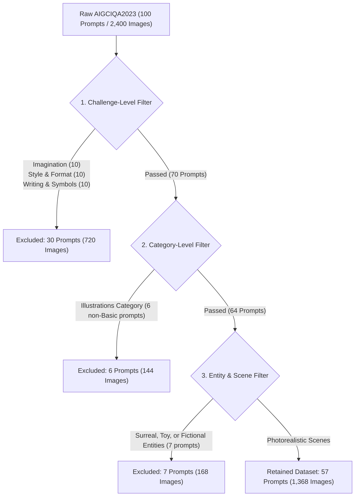

# AIGCIQA2023 Dataset Exclusion Criteria & Manifest

This document details the filtering criteria, taxonomy, and file manifest used to select the photographic subset of the **AIGCIQA2023** benchmark (Wang et al., 2023) for our research on AI-generated image authenticity.

---

## 1. Overview & Research Objective

The primary objective of this project is to model and predict human perception of **authenticity in photographic scenes**. 

In the raw **AIGCIQA2023** dataset, prompts were designed to benchmark text-to-image models across a wide variety of dimensions, including typography rendering, stylized illustrations, abstract art, and physically impossible counterfactual scenarios. However, human perceptual judgments of "authenticity" differ fundamentally across visual domains:
- In **photographic imagery**, authenticity reflects perceptual plausibility, photorealism, and the absence of generative artifacts (e.g., unnatural textures, anatomical distortions, lighting inconsistencies).
- In **stylized artwork or illustrations** (e.g., oil paintings, emojis, cartoons), observers evaluate artistic execution or stylistic fidelity rather than real-world authenticity.
- In **counterfactual or fantasy scenes** (e.g., chimeras, animals wearing human clothing), the conceptual impossibility of the prompt introduces semantic confounders that obscure purely visual authenticity perception.

To isolate photographic authenticity, we applied a systematic prompt-level filtering procedure to retain only natural, photorealistic candidate scenes.

---

## 2. Dataset Structure & Partition

The raw AIGCIQA2023 benchmark comprises:
- **100 text prompts** distributed across 10 challenges and multiple semantic categories.
- **6 generative models**: ControlNet, DeepFloyd-IF, Dreamlike, GLIDE, Stable Diffusion 1.5, and Stable Diffusion 2.1.
- **4 generated images per prompt per model**.
- **Total raw images**: $100 \text{ prompts} \times 6 \text{ models} \times 4 \text{ images} = 2{,}400 \text{ images}$.

### Prompt-Level Filtering Strategy
Filtering is performed strictly at the **text-prompt level**:
- If a prompt is selected for exclusion, **all 24 associated generated images** (across all 6 models) are excluded together.
- This maintains complete model balance across the retained subset: every generative model is evaluated on the exact same set of prompts.

The resulting dataset partition is:
- **Retained Subset**: **57 prompts** $\times$ 24 images = **1,368 images** (228 images per model)
- **Excluded Subset**: **43 prompts** $\times$ 24 images = **1,032 images** (172 images per model)

---

## 3. Exclusion Rules & Taxonomy

Prompts were excluded based on three hierarchical criteria:



### Rule 1: Challenge-Level Exclusions (30 Prompts / 720 Images)
Three complete challenges in AIGCIQA2023 specifically target non-photographic, counterfactual, or symbolic capabilities. All prompts within these challenges are excluded:
1. **`Imagination` (10/10 prompts excluded)**: Prompts describing physically impossible, counterfactual, or chimeric concepts (e.g., *"A blue colored dog"*, *"an elephant walking on the Great Wall"*, *"a fountain that has milk instead of water"*).
2. **`Style & Format` (10/10 prompts excluded)**: Prompts explicitly targeting non-photographic artistic media and artistic movements (e.g., *"an oil painting of a tree"*, *"pop art style portrait"*, *"ink wash"*, *"A photo of a panda made of water"*).
3. **`Writing & Symbols` (10/10 prompts excluded)**: Prompts designed to evaluate legible text rendering, typography, logos, and signage (e.g., *"A sign that says Deep Learning"*, *"the word 'START'"*).

### Rule 2: Category-Level Exclusions (6 Prompts / 144 Images)
Across the remaining challenges, prompts categorized under **`Illustrations`** prompt the generator to create non-photographic graphics, emojis, cartoon figures, and line drawings (e.g., *"A set of 2x2 emoji icons"*, *"wide-angle view comic book illustration"*, *"a kids' book cover with an illustration of white dog"*).
*(Note: One prompt under the Basic challenge, "a book cover", was retained as it depicts a physical photograph of a book object).*

### Rule 3: Entity & Scene-Level Exclusions (7 Prompts / 168 Images)
Within otherwise realistic photographic categories (Animals, Artifacts, World Knowledge), prompts that specify surreal juxtapositions, toy/plastic objects, or cartoonish interactions conflict with real-world scene plausibility:
- **Surreal / fantasy interactions**:
  - *Animals (Complex)*: *"A donkey is playing tug-of-war against an octopus. The donkey holds the rope in its mouth. A cat is jumping over the rope."*
  - *Animals (Fine-grained Detail)*: *"a dolphin in an astronaut suit on saturn"*
  - *Artifacts (Complex)*: *"a propaganda poster depicting a cat dressed as french emperor napoleon holding a piece of cheese"*
  - *World Knowledge (Complex)*: *"An anime illustration of Sydney Opera House sitting next to Eiffel tower..."*
- **Toy or miniature plastic models**:
  - *Artifacts (Fine-grained Detail)*: *"purple lego dollhouse with a pool and a swing"*
  - *Artifacts (Simple Detail)*: *"a teddy bear on a skateboard"*
  - *World Knowledge (Fine-grained Detail)*: *"a teddy bear on a skateboard in times square"*

---

## 4. Complete Catalog of the 43 Excluded Prompts

| # | Challenge | Category | Prompt Text | Primary Exclusion Rule |
|---|---|---|---|---|
| 1 | Complex | Animals | *A donkey is playing tug-of-war against an octopus. The donkey holds the rope in its mouth. A cat is jumping over the rope.* | Rule 3: Surreal entity interaction |
| 2 | Complex | Artifacts | *a propaganda poster depicting a cat dressed as french emperor napoleon holding a piece of cheese* | Rule 3: Anthropomorphic poster art |
| 3 | Complex | Illustrations | *A set of 2x2 emoji icons with happy, angry, surprised and sobbing faces. The emoji icons look like colorful macarons. All of the macarons are wearing cowboy hats.* | Rule 2: Non-photographic illustration / emoji |
| 4 | Complex | World Knowledge | *An anime illustration of Sydney Opera House sitting next to Eiffel tower, under a blue night sky of roiling energy, exploding yellow stars, and radiating swirls of blu* | Rule 3: Anime style and impossible geography |
| 5 | Fine-grained Detail | Animals | *a dolphin in an astronaut suit on saturn* | Rule 3: Surreal / fantasy scene |
| 6 | Fine-grained Detail | Artifacts | *purple lego dollhouse with a pool and a swing* | Rule 3: Toy / miniature plastic object |
| 7 | Fine-grained Detail | Illustrations | *a kids' book cover with an illustration of white dog driving a red pickup truck* | Rule 2: Children's book illustration |
| 8 | Fine-grained Detail | World Knowledge | *a teddy bear on a skateboard in times square* | Rule 3: Toy entity in scene |
| 9 | Imagination | Animals | *A blue colored dog* | Rule 1: Imagination challenge (unnatural color) |
| 10 | Imagination | Artifacts | *a sword slicing through a loaf of bread* | Rule 1: Imagination challenge |
| 11 | Imagination | Food & Beverage | *A bowl of soup that looks like a monster with tofu says deep learning* | Rule 1: Imagination challenge (monster/text) |
| 12 | Imagination | Illustrations | *a drawing of a series of musical notes wrapped around the Earth* | Rule 1: Imagination challenge (abstract drawing) |
| 13 | Imagination | Indoor Scenes | *a small kitchen with a white goat in it* | Rule 1: Imagination challenge (incongruent indoor) |
| 14 | Imagination | Outdoor Scenes | *A large city fountain that has milk instead of water. Several cats are leaning into the fountain.* | Rule 1: Imagination challenge (counterfactual fluid) |
| 15 | Imagination | People | *A photo of an astronaut riding a horse in the forest.* | Rule 1: Imagination challenge (surreal juxtaposition) |
| 16 | Imagination | Produce & Plants | *an orange wearing a cowboy hat* | Rule 1: Imagination challenge (anthropomorphic fruit) |
| 17 | Imagination | Vehicles | *A bicycle on top of a boat* | Rule 1: Imagination challenge (impossible vehicle stack) |
| 18 | Imagination | World Knowledge | *an elephant walking on the Great Wall* | Rule 1: Imagination challenge (incongruent wildlife) |
| 19 | Linguistic Structures | Illustrations | *We painted the wall with cracks.* | Rule 2: Graphic / painted surface illustration |
| 20 | Perspective | Illustrations | *A robot with a black visor and the number 42 on its chest. It stands proudly in front of an F1 race car. The sun is setting on a cityscape in the background. wide-angle view. comic book illustration.* | Rule 2: Comic book illustration |
| 21 | Quantity | Illustrations | *three small yellow boxes* | Rule 2: Graphic illustration |
| 22 | Simple Detail | Artifacts | *a teddy bear on a skateboard* | Rule 3: Toy entity |
| 23 | Simple Detail | Illustrations | *A heart made of chocolate* | Rule 2: Graphic design / illustration |
| 24 | Style & Format | Animals | *A photo of a panda made of water.* | Rule 1: Style & Format challenge (water sculpture) |
| 25 | Style & Format | Artifacts | *A spaceship made of cardboard.* | Rule 1: Style & Format challenge (cardboard craft) |
| 26 | Style & Format | Arts | *an oil painting of a tree and a building* | Rule 1: Style & Format challenge (oil painting) |
| 27 | Style & Format | Food & Beverage | *a painting of the food of china* | Rule 1: Style & Format challenge (painting medium) |
| 28 | Style & Format | Illustrations | *an emoji of a baby penguin wearing a blue hat, red gloves, green shirt, and yellow pants* | Rule 1: Style & Format challenge (emoji art) |
| 29 | Style & Format | Outdoor Scenes | *a painting of a white country home with a wrap-around porch* | Rule 1: Style & Format challenge (painting medium) |
| 30 | Style & Format | People | *a portrait of a man wearing sunglasses and a business suit, painting in pop art style* | Rule 1: Style & Format challenge (pop art style) |
| 31 | Style & Format | Produce & Plants | *A photo of a lotus flower made of water.* | Rule 1: Style & Format challenge (water sculpture) |
| 32 | Style & Format | Vehicles | *a cartoon of a train going to the moon* | Rule 1: Style & Format challenge (cartoon medium) |
| 33 | Style & Format | World Knowledge | *Downtown Shanghai at sunrise. detailed ink wash.* | Rule 1: Style & Format challenge (ink wash art) |
| 34 | Writing & Symbols | Animals | *a cartoon of a dog saying "I see what you did there"* | Rule 1: Writing & Symbols challenge (speech balloon) |
| 35 | Writing & Symbols | Artifacts | *A sign that says Deep Learning* | Rule 1: Writing & Symbols challenge (signage text) |
| 36 | Writing & Symbols | Food & Beverage | *Two cups of coffee, one with latte art of the words "LOVE" written in one. The other has latte art of the words "PEACE" written in the other.* | Rule 1: Writing & Symbols challenge (text rendering) |
| 37 | Writing & Symbols | Illustrations | *the word 'START'* | Rule 1: Writing & Symbols challenge (typography) |
| 38 | Writing & Symbols | Indoor Scenes | *a yellow wall with 'Hello, world.' written on it* | Rule 1: Writing & Symbols challenge (wall graffiti) |
| 39 | Writing & Symbols | Outdoor Scenes | *a store front with 'Grassy Meadow' written on it* | Rule 1: Writing & Symbols challenge (storefront sign) |
| 40 | Writing & Symbols | People | *the word 'HELLO' on a girl's face* | Rule 1: Writing & Symbols challenge (face text) |
| 41 | Writing & Symbols | Produce & Plants | *the word 'APPLE' on an apple* | Rule 1: Writing & Symbols challenge (inscribed fruit text) |
| 42 | Writing & Symbols | Vehicles | *a hot air balloon with chameleon logo. the sun is shining and puffy white clouds are in the background.* | Rule 1: Writing & Symbols challenge (logo branding) |
| 43 | Writing & Symbols | World Knowledge | *A green sign that says "Very Deep Learning" and is at the edge of the Grand Canyon.* | Rule 1: Writing & Symbols challenge (signpost text) |

---

## 5. Retained Dataset Distribution (57 Prompts / 1,368 Images)

The 57 retained prompts span natural scenes and realistic objects across the remaining benchmark challenges:

| Challenge | Total Prompts | Retained Prompts | Excluded Prompts | Retained Images | Excluded Images |
|---|:---:|:---:|:---:|:---:|:---:|
| **Basic** | 10 | **10** | 0 | 240 | 0 |
| **Complex** | 10 | **6** | 4 | 144 | 96 |
| **Fine-grained Detail** | 10 | **6** | 4 | 144 | 96 |
| **Imagination** | 10 | **0** | 10 | 0 | 240 |
| **Linguistic Structures** | 10 | **9** | 1 | 216 | 24 |
| **Perspective** | 10 | **9** | 1 | 216 | 24 |
| **Quantity** | 10 | **9** | 1 | 216 | 24 |
| **Simple Detail** | 10 | **8** | 2 | 192 | 48 |
| **Style & Format** | 10 | **0** | 10 | 0 | 240 |
| **Writing & Symbols** | 10 | **0** | 10 | 0 | 240 |
| **Total** | **100** | **57** | **43** | **1,368** | **1,032** |

Across all 6 generative models:
- **ControlNet**: 228 retained images
- **DeepFloyd-IF**: 228 retained images
- **Dreamlike**: 228 retained images
- **GLIDE**: 228 retained images
- **Stable Diffusion 1.5**: 228 retained images
- **Stable Diffusion 2.1**: 228 retained images
- **Total**: $228 \times 6 = \mathbf{1{,}368 \text{ images}}$

---

## 6. Associated Repository Files

All files associated with this filtering protocol are located in `Image_Authenticity_prediction/Dataset/AIGCIQA2023/`:

1. **`real_images_annotations.csv`**:
   The primary experimental annotations file used by `ImageAuthenticityDataset`. Contains Mean Opinion Scores (`Quality`, `Authenticity`, `Correspondence`), model name, challenge, category, prompt, and image paths for the 1,368 retained images.
2. **`prompt_exclusion_manifest.csv`**:
   Comprehensive audit manifest of all 100 benchmark prompts, indicating challenge, category, prompt text, status (`Kept` vs. `Removed`), and the specific exclusion rule applied.
3. **`removed_images_details.csv`**:
   Full tabular metadata and MOS scores for the 1,032 excluded images.
4. **`removed_images_summary.csv`**:
   Aggregated breakdown of the 1,032 excluded images by challenge and category.
5. **`removed_images.txt`**:
   Plain-text list of file paths for the 1,032 excluded images (used by `analysis_noise_ceiling.py` to filter single scores).

---

## 7. Automated Verification

The dataset partition, model balance, and disjointness can be programmatically verified using pytest:

```bash
uv run pytest tests/test_dataset_exclusions.py -v
```
